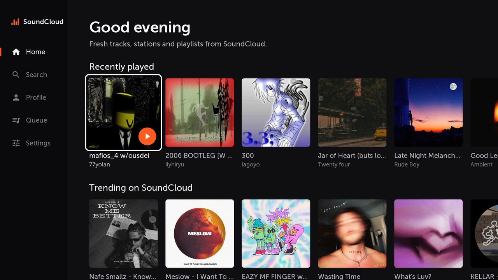
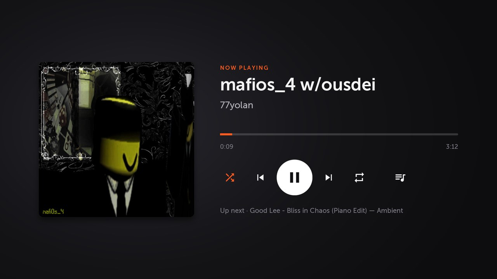

# SoundCloud for LG webOS TVs

A SoundCloud player for LG TVs, built for the remote. SoundCloud has no LG app and its website
refuses the browsers in older sets, so this is a small native app that talks to SoundCloud itself:
browse, search, queue and listen from the couch.





*Frames captured from an LG 75UM7600 (2019, webOS 4).*

## Features

- **Home:** the tracks and playlists you played recently, trending tracks, SoundCloud's curated
  selections and more like your last track.
- **Search:** tracks, playlists, albums and artists, with your recent searches.
- **Your profiles, without logging in:** add one or more SoundCloud accounts by name or link to
  get their public likes, playlists and tracks, stacked in the order you choose.
- **Playback:** a queue with shuffle and repeat, seeking, and autoplay of similar tracks when the
  queue ends. A mini-player stays on screen while you browse.
- **Made for the remote:** arrows, OK and Back everywhere, the media keys, and the Magic Remote
  pointer and wheel.
- **Readable titles:** stylised letters (𝙇𝙤𝙛𝙞, Ⓛⓞⓕⓘ, ＬＯＦＩ) are shown as plain text, and emoji and
  symbols draw from bundled fonts where the TV has none.
- **Nothing extra:** no ads, no trackers, no account, no background service. About 0.8 MB
  installed.

## Will it work on my TV?

| | |
|---|---|
| Tested | LG 75UM7600PLB (2019), webOS TV Lite 4.10.2, Chromium 53, 1 GB RAM |
| Should work | Other webOS 4 and newer sets: the app is written for the oldest engine and uses nothing newer |
| Needs | A way to install an `.ipk`: LG Developer Mode, or a rooted TV with the Homebrew Channel |

Only the first row has been tried. If you run it on another model, an issue saying how it went is
welcome.

## Install

1. Download the `.ipk` from [Releases](../../releases), or build it (below).
2. Install it one of these ways:
   - **webOS Dev Manager** ([webosbrew/dev-manager-desktop](https://github.com/webosbrew/dev-manager-desktop)):
     add your TV, then Apps → Install and pick the file.
   - **LG's command line tools:** `ares-install --device <tv> local.soundcloud.tv_<version>_all.ipk`
   - **A rooted TV, from its shell:** copy the file to `/tmp` and run
     `luna-send -n 1 luna://com.webos.appInstallService/dev/install '{"id":"com.ares.defaultName","ipkUrl":"/tmp/<file>.ipk","subscribe":true}'`
3. Open **SoundCloud** from the TV's app list.

With Developer Mode (not rooted), LG removes sideloaded apps when the Developer Mode session
expires, so keep the session extended.

## Using it

| Remote | Does |
|---|---|
| Arrows / OK | Move and select |
| Back | Up one screen (on Home it asks before leaving) |
| Play, Pause, Stop | Control playback |
| Fast forward / Rewind | Seek 15 seconds |
| Left / Right on the progress bar | Seek 10 seconds |
| Red | Open or close Now playing |
| Pointer and wheel | Point to focus, click to select, scroll rows |

Search opens the TV's own keyboard. Volume is the TV's.

To add a profile, open **Profile → Add a profile** and type a name, a username or a
`soundcloud.com/...` link; matching accounts appear as you type, and OK on one adds it. Each
profile has **Move up**, **Move down** and **Remove** buttons next to its name.

Your profiles, recent searches, recently played tracks and playlists, and settings are kept on
the TV only.

## Build

Python 3 is all it needs; there are no dependencies and no build step for the app itself.

```sh
python build.py     # writes build/local.soundcloud.tv_<version>_all.ipk
```

The app is plain HTML, CSS and JavaScript in [`app/`](app). How it plays audio on old TVs, the
SoundCloud endpoints it uses, the debug build and its self-test, and the font pipeline are in
[docs/DEVELOPMENT.md](docs/DEVELOPMENT.md).

## Good to know

- **Unofficial.** This project is not affiliated with or endorsed by SoundCloud. It uses the same
  public web API as soundcloud.com, with no API key of its own, so a change on SoundCloud's side
  can break it without notice.
- **No login.** Private tracks, your stream and SoundCloud Go+ content are not available. Tracks
  that only offer a 30-second preview are labelled "Preview", and DRM-only tracks are skipped.
- **Streaming only.** Nothing is downloaded or saved. Please respect artists and
  [SoundCloud's terms](https://soundcloud.com/terms-of-use).
- **Emoji are monochrome.** The engine in these TVs cannot use colour emoji fonts.
- The icon is a plain cloud, not SoundCloud's logo.

## Licence

The code is under the [MIT licence](LICENSE). The fonts in `app/fonts/` are Noto fonts under the
SIL Open Font License 1.1; their licence texts sit next to them. "SoundCloud" is a trademark of its
owner and is used here only to say what the app connects to.
